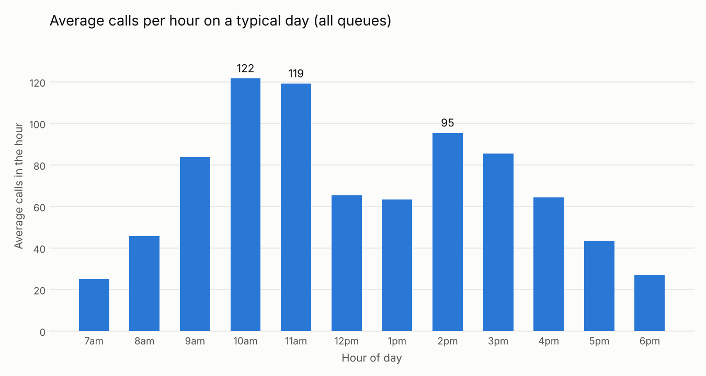

# Call Volume Agent

A small AI agent that answers plain-English questions about contact center
call volume and draws a chart. A learning project built with Claude.
The data is synthetic.

Run (Windows PowerShell):
1. `python -m pip install -r requirements.txt`
2. `setx ANTHROPIC_API_KEY "your-key"` (then open a new terminal)
3. `python agent.py data/sample_calls_4wk.csv "Which hours of the day get the most calls?"`

Python does all the math. Claude chooses the tools and explains the result.
What was built and tested, step by step: [PROJECT_LOG.md](PROJECT_LOG.md)

License: MIT
